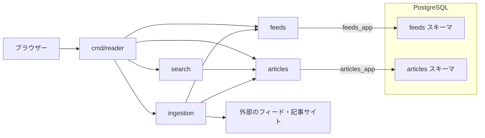
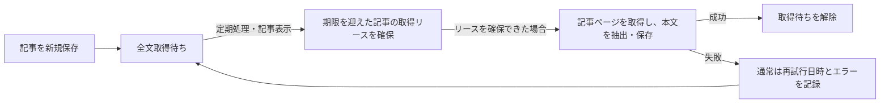

# RSS Reader コードベースガイド

RSS Reader は、RSS・Atom の購読、記事の閲覧・保存、検索、OPML の入出力に対応する個人用リーダーです。このガイドは、画面やコマンドを起点に処理をたどり、変更箇所を見つけるための開発者向け資料です。

関連資料は [起動手順](../README.md)・[開発ルール](../AGENTS.md)・[設計方針](architecture.md) を参照してください。

## 全体構成

Go の単一バイナリが Web サーバー、取得コマンド、マイグレーションを提供します。Web サーバーは `net/http` と `html/template` で画面を生成し、素の JavaScript で記事ペインの更新や追加読み込みを行います。購読と記事は同じ PostgreSQL にあり、モジュールごとにスキーマと接続ユーザーを分けています。

下図の矢印は、Web と取得処理における主な呼び出し・接続の方向を示します。

| 場所 | 役割 |
| --- | --- |
| [cmd/reader](../cmd/reader) | コマンドの分岐、DB 接続、HTTP ルーティング、画面テンプレート、ブラウザー操作、定期実行を組み立てる |
| [internal/feeds](../internal/feeds) | 購読・フォルダーの保存、取得予定と結果の管理、OPML の解析・生成 |
| [internal/articles](../internal/articles) | 記事、既読・お気に入り、削除状態、全文取得待ち、検索 SQL の管理 |
| [internal/ingestion](../internal/ingestion) | フィードの取得・解析と記事保存の調整、記事ページからの本文抽出 |
| [internal/search](../internal/search) | 検索の入口。記事ストアの検索を呼び出す |
| [migrations](../migrations) | テーブル、インデックス、権限、既存データの更新を番号付き SQL で管理 |
| [architecture](../architecture) | Go パッケージ間の依存方向をテストで検査 |
| [compose.yaml](../compose.yaml)・[Dockerfile](../Dockerfile)・[docker/init-db.sh](../docker/init-db.sh) | ローカルの起動・検証環境、バイナリのビルド、DB ロールの初期化 |

## 起動とコマンド

[main.go](../cmd/reader/main.go) がコマンドを選び、用途に応じて接続やサービスを初期化します。Compose の通常起動は、DB のヘルスチェック、マイグレーションの正常終了、Web の起動の順です。

| コマンド | 動作 |
| --- | --- |
| `reader web` | 既定のコマンド。HTTP サーバーを起動し、`AUTO_REFRESH` が有効なら同じプロセスで定期取得を実行する |
| `reader fetch` | 次回取得時刻にかかわらず、購読中のフィードを一巡する |
| `reader fetch --due` | 期限を迎えたフィードを一巡し、記事の全文取得待ちも処理する。Web の定期処理と同じ処理を使う |
| `reader migrate` | 管理者用の `DATABASE_URL` で未適用の SQL を順番に実行する |
| `reader healthcheck` | ローカルの `/healthz` を確認する。ハンドラーは両方のアプリ用 DB 接続を確認する |

Web と取得コマンドは、購読ストアに `FEEDS_DATABASE_URL`、記事ストアに `ARTICLES_DATABASE_URL` を使います。設定例は [.env.example](../.env.example) を参照してください。

Web の定期処理が有効な場合、起動直後に期限を確認し、各処理の終了から1分後に次の確認を行います。各フィードの次回取得時刻は、基本間隔の `FETCH_INTERVAL`（既定30分）とフィードの TTL の長い方を使って決めます。 [定期実行](../cmd/reader/polling.go)・[取得結果の記録](../internal/feeds/feeds.go)

## 主な処理の流れ

### 一覧・検索・記事を開く操作

1. `GET /` で `application.base` が購読、フォルダー、未読件数を集め、検索語や絞り込み条件を記事一覧のクエリに変換します。`search.Service.Find` は `articles.Store.Search` に処理を渡します。
2. 記事ストアは、タイトル・フィード本文のテキスト・取得済み全文のテキストを PostgreSQL の `ILIKE` で部分一致検索します。一覧の SELECT は表示用のメタデータを返し、記事を開く際に DB から保存済みの本文を読み込みます。
3. [page.html](../cmd/reader/page.html) は購読サイドバー、記事一覧、右の記事ペインを描画します。[reader.js](../cmd/reader/reader.js) は記事を開くときに `POST /articles/{id}/open` を呼び、サーバーが既読にした記事の HTML で右ペインを更新します。未読一覧で既読になった行は同じ位置に残り、グレーアウトします。
4. 自動ページ送りは続きを一覧に追加します。追加取得は記事の公開日時と ID を境界にするため、境界の記事が既読になって未読検索の対象から外れた後も、その記事の位置から続きを取得できます。

実装の入口は [web.go](../cmd/reader/web.go)、検索 SQL は [articles.go](../internal/articles/articles.go) にあります。

### 購読登録・フォルダー・OPML

購読とフォルダーの操作は HTTP ハンドラーがフォームを受け取り、`feeds.Store` が反映します。フォルダーへの所属、表示順、開閉状態は DB に保存します。購読解除は購読を無効化する操作で、取得済みの記事は引き続き保存されます。 [購読ストア](../internal/feeds/feeds.go)・[フォルダーストア](../internal/feeds/folders.go)

OPML は `POST /feeds/import` で受け付け、ファイル全体を検証してから一つのトランザクションで取り込みます。既存の有効な購読は維持し、解除済みの URL は同じ ID で再購読します。新規購読には OPML から読み取ったフォルダーを設定できます。`GET /feeds/export.opml` は有効な購読をフォルダーでグループ化して OPML 2.0 を返します。 [OPML の HTTP 処理](../cmd/reader/opml.go)・[OPML の解析と保存](../internal/feeds/opml.go)

### フィード取得

手動更新と定期取得は、フィード取得を担う `ingestion.Service` を共有します。定期取得は期限が来た購読を選び、手動更新は期限にかかわらず取得します。購読直後の取得では対象フィードを指定します。

1. `feeds.Store.WithRefreshLock` が PostgreSQL のアドバイザリロックでフィード取得の重複を防ぎます。
2. 取得サービスが HTTP の検証子（ETag と Last-Modified）を使って条件付きリクエストを送り、更新があれば RSS・Atom を解析して記事を保存します。
3. 記事の保存が終わった後に新しい HTTP 検証子を記録します。304 応答の場合は記事の保存を省き、次回取得時刻を更新します。フィード単位の失敗があっても、ほかの対象の処理を続けます。

[取得処理](../internal/ingestion/ingestion.go)・[購読の取得状態](../internal/feeds/feeds.go)

### 記事全文の取得と表示

フィードから取得した記事と手動で登録した記事は、新規保存と同時に全文取得待ちになります。定期処理は実行可能な記事を一度に最大10件選び、1件ずつ取得します。記事を表示したブラウザーも状態確認 API を呼びます。`POST /articles/{id}/content-status` は取得可能な待機中記事の処理を試み、`GET` は状態を返します。

通常の失敗では再試行を30分後に設定します。取得リースは2分で期限切れになり、HTTP 通信中は DB トランザクションを保持しません。取得・抽出した全文はフィード由来の本文と別に保存します。画面は全文を優先し、外部由来の HTML を表示直前に許可リストでサニタイズします。表示中の記事で取得が完了するかエラー状態が変わると、ブラウザーが右ペインを更新します。 [取得待ちの処理](../internal/ingestion/content_queue.go)・[本文抽出](../internal/ingestion/full_article.go)・[HTML の表示処理](../cmd/reader/article_html.go)

## データモデルと権限

| テーブル | 内容 |
| --- | --- |
| `feeds.subscriptions` | 購読 URL、名前、フォルダー、購読状態、HTTP 検証子、次回取得時刻、取得結果 |
| `feeds.folders` | フォルダー名と表示順 |
| `feeds.closed_folders` | 閉じているフォルダー |
| `articles.entries` | 記事本体、公開日時、既読・お気に入り・削除状態、取得済み全文、再試行とリースの情報 |
| `public.schema_migrations` | 適用済みマイグレーションのファイル名 |

記事の `source_id` は購読 ID に対応する値で、手動登録は `0` です。購読との対応付けはアプリが扱います。`(source_id, external_id)` の一意制約で重複を防ぎ、再取得では既読・お気に入り・取得済み全文を維持します。削除済みのフィード記事は再取得でも削除状態を維持します。

`feeds_app` と `articles_app` にはそれぞれ所有スキーマへの権限を付与します。`/admin/database` はアプリ用ストアを通じて上記の購読・フォルダー・記事のテーブルを読み取る管理画面です。スキーマを変更するときは次の番号の SQL ファイルを追加します。 [初期スキーマと権限](../migrations/001_initial.sql)・[マイグレーション実行処理](../migrations/migrate.go)・[DB 管理画面](../cmd/reader/database.go)

## 変更箇所を探す

| 変更したいこと | 最初に読む場所 |
| --- | --- |
| 画面の構成・表示 | [page.html](../cmd/reader/page.html)、[web.go](../cmd/reader/web.go) |
| キーボード操作・記事ペイン・自動ページ送り | [reader.js](../cmd/reader/reader.js) |
| 検索対象・絞り込み・並び順 | [web.go](../cmd/reader/web.go) のクエリ組み立て、[articles.go](../internal/articles/articles.go) の `Search` |
| 購読・フォルダー・OPML | [feeds](../internal/feeds) と [cmd/reader](../cmd/reader) の対応する HTTP ハンドラー |
| 取得周期・フィード取得・全文抽出 | [polling.go](../cmd/reader/polling.go)、[ingestion](../internal/ingestion)、各ストアの次回取得時刻の更新 |
| DB スキーマ・モジュール間依存 | [migrations](../migrations)、[dependencies_test.go](../architecture/dependencies_test.go) |

## 検証

- `go test ./...` で Go のテストとモジュール依存の検査を実行します。
- `node --check cmd/reader/reader.js` で JavaScript の構文を確認します。
- `docker compose --profile test run --build --rm test` で実 PostgreSQL を使う統合テストも実行します。統合テストは専用 DB を作り、マイグレーション、機能の組み合わせ、モジュール間の DB 権限を検証します。 [統合テスト](../cmd/reader/integration_test.go)
