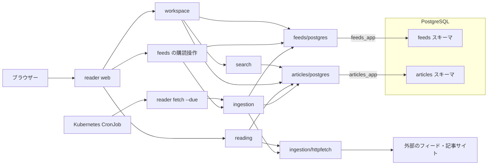

# RSS Reader コードベースガイド

RSS Reader は、RSS・Atom の購読、記事の閲覧・保存、検索、OPML の入出力に対応する個人用リーダーです。このガイドは、画面やコマンドを起点に処理をたどり、変更箇所を見つけるための開発者向け資料です。

関連資料は [起動手順](../README.md)・[開発ルール](../AGENTS.md)・[設計方針](architecture.md) を参照してください。

## 全体構成

Go の単一バイナリが Web サーバー、取得コマンド、マイグレーションを提供します。Web サーバーは `net/http` と `html/template` で画面を生成し、素の JavaScript で記事ペインの更新や追加読み込みを行います。購読と記事は同じ PostgreSQL にあり、モジュールごとにスキーマと接続ユーザーを分けています。

下図の矢印は、Web と取得処理における主な呼び出し・接続の方向を示します。

| 場所 | 役割 |
| --- | --- |
| [cmd/reader](../cmd/reader) | コマンドの分岐、DB 接続、依存関係の組み立て、HTTP ルーティング、画面テンプレート、ブラウザー操作 |
| [internal/config](../internal/config) | コマンドごとの環境変数の読み込み、既定値、入力検証 |
| [internal/feeds](../internal/feeds) | 購読・フォルダーの型と検証、購読と初回取得の調整、OPML の解析・生成 |
| [internal/feeds/postgres](../internal/feeds/postgres) | 購読・フォルダーの保存、OPML のトランザクション、取得予定・結果の記録、取得ロック |
| [internal/articles](../internal/articles) | 記事・本文・検索条件の型と保存時の入力検証 |
| [internal/articles/postgres](../internal/articles/postgres) | 記事・既読・お気に入り・閲覧履歴の保存、検索 SQL、全文取得のリース |
| [internal/workspace](../internal/workspace) | 記事一覧と購読サイドバーに必要なデータの組み立て |
| [internal/reading](../internal/reading) | 既読化、閲覧記録、全文取得と再取得の調整 |
| [internal/ingestion](../internal/ingestion) | フィードの選択、排他、記事と取得結果の保存の調整 |
| [internal/ingestion/httpfetch](../internal/ingestion/httpfetch) | 外部HTTP通信、RSS・Atomの解析、記事ページからの本文抽出 |
| [internal/search](../internal/search) | 検索の入口。記事ストアの検索を呼び出す |
| [migrations](../migrations) | テーブル、インデックス、権限、既存データの更新を番号付き SQL で管理 |
| [architecture](../architecture) | Go パッケージ間の依存方向をテストで検査 |
| [compose.yaml](../compose.yaml)・[Dockerfile](../Dockerfile)・[docker/init-db.sh](../docker/init-db.sh) | ローカルの起動・検証環境、バイナリのビルド、DB ロールの初期化 |

## 起動とコマンド

[main.go](../cmd/reader/main.go) がコマンドを選び、`config.LoadConfig` で用途に合った設定を読み込んでから、接続やサービスを初期化します。Compose の通常起動は、DB のヘルスチェック、マイグレーションの正常終了、Web の起動の順です。

| コマンド | 動作 |
| --- | --- |
| `reader web` | 既定のコマンド。HTTP サーバーを起動する |
| `reader fetch` | 次回取得時刻にかかわらず、購読中のフィードを一巡する |
| `reader fetch --due` | 期限を迎えたフィードを一巡する。Kubernetes では CronJob が呼び出す |
| `reader migrate` | 管理者用の `DATABASE_URL` で未適用の SQL を順番に実行する |
| `reader healthcheck` | ローカルの `/healthz` を確認する。ハンドラーは両方のアプリ用 DB 接続を確認する |

Web と取得コマンドは、購読ストアに `FEEDS_DATABASE_URL`、記事ストアに `ARTICLES_DATABASE_URL` を使います。設定例は [.env.example](../.env.example) を参照してください。

ローカルでは `docker compose exec web /app/reader fetch --due` で期限に達したフィードを取得できます。Kubernetes の CronJob は1分ごとに取得期限を確認します。各フィードの次回取得時刻は、基本間隔の `FETCH_INTERVAL`（既定30分）とフィードの TTL の長い方を使って決めます。 [定期実行](../k8s/reader/fetch.yaml)・[取得結果の記録](../internal/feeds/postgres/store.go)

## 主な処理の流れ

### 一覧・検索・記事を開く操作

1. `GET /` で `application.base` が検索語や絞り込み条件を記事一覧のクエリに変換します。`workspace.Service.Load` が購読、フォルダー、未読件数、検索結果を組み立てます。`search.Service.Find` は記事の PostgreSQL ストアに検索を委ねます。
2. 記事ストアは、タイトル・フィード本文のテキスト・取得済み全文のテキストを PostgreSQL の `ILIKE` で部分一致検索します。一覧の SELECT は表示用のメタデータを返し、記事を開く際に DB から保存済みの本文を読み込みます。
3. [page.html](../cmd/reader/page.html) は購読サイドバー、記事一覧、右の記事ペインを描画します。[reader.js](../cmd/reader/reader.js) は記事を開くときに `POST /articles/{id}/open` を呼び、サーバーが既読にした記事の HTML で右ペインを更新します。未読一覧で既読になった行は同じ位置に残り、グレーアウトします。
4. 自動ページ送りは続きを一覧に追加します。未読やお気に入りの一覧では、公開日時と ID を境界にするため、境界の記事が絞り込みの対象から外れても続きを取得できます。閲覧履歴では閲覧日時と ID を境界にします。

実装の入口は [web.go](../cmd/reader/web.go)、検索 SQL は [articles/postgres/search.go](../internal/articles/postgres/search.go) にあります。

### 購読登録・フォルダー・OPML

HTTP ハンドラーがフォームを受け取り、`feeds.SubscriptionService` が購読の保存と初回取得を調整します。フォルダーの変更は購読の PostgreSQL ストアが反映します。フォルダーへの所属、表示順、開閉状態は DB に保存します。購読解除は購読を無効化する操作で、取得済みの記事は引き続き保存されます。 [購読ストア](../internal/feeds/postgres/store.go)・[フォルダーストア](../internal/feeds/postgres/folders.go)

OPML は `POST /feeds/import` で受け付け、ファイル全体を検証してから一つのトランザクションで取り込みます。既存の有効な購読は維持し、解除済みの URL は同じ ID で再購読します。新規購読には OPML から読み取ったフォルダーを設定できます。`GET /feeds/export.opml` は有効な購読をフォルダーでグループ化して OPML 2.0 を返します。 [OPML の HTTP 処理](../cmd/reader/opml.go)・[OPML の解析・生成](../internal/feeds/opml.go)・[OPML の保存](../internal/feeds/postgres/opml.go)

### フィード取得

手動更新と定期取得は、フィード取得を担う `ingestion.Service` を共有します。定期取得は期限が来た購読を選び、手動更新は期限にかかわらず取得します。購読直後の取得では対象フィードを指定します。

1. 購読の PostgreSQL ストアの `WithRefreshLock` が PostgreSQL のアドバイザリロックでフィード取得の重複を防ぎます。
2. `httpfetch.Client` が HTTP の検証子（ETag と Last-Modified）を使って条件付きリクエストを送り、更新があれば RSS・Atom を解析します。`ingestion.Service` が記事を保存します。
3. 記事の保存が終わった後に新しい HTTP 検証子を記録します。304 応答の場合は記事の保存を省き、次回取得時刻を更新します。フィード単位の通信・解析エラーは `last_error` に記録してほかの対象の処理を続けます。定期取得は記録できた個別エラーを理由に失敗扱いにはしません。DBへの保存失敗や実行全体のタイムアウトはジョブの失敗になります。

[取得処理](../internal/ingestion/ingestion.go)・[HTTP取得・解析](../internal/ingestion/httpfetch/feed.go)・[購読の取得状態](../internal/feeds/postgres/store.go)

### 記事全文の取得と表示

ブラウザーが記事の本文ペインを表示すると、`POST /articles/{id}/content-status` が `reading.Service.Display` を呼び、閲覧を記録します。表示IDの再送による重複は記事ストアが防ぎます。全文が未取得で失敗記録がなければ、記事単位のリースを確保して取得を試みます。`GET` は現在の取得状態を返します。

取得に失敗すると、RSS本文や要約とともに失敗を表示します。「本文を再取得」を押すと、表示中の記事の全文を再取得します。定期処理が取得するのはフィードです。全文は別テーブルに保存し、画面では表示直前に許可リストでサニタイズします。[閲覧と本文取得の調整](../internal/reading/reading.go)・[本文抽出](../internal/ingestion/httpfetch/article.go)・[HTMLの表示処理](../cmd/reader/article_html.go)

## データモデルと権限

| テーブル | 内容 |
| --- | --- |
| `feeds.subscriptions` | 購読 URL、名前、フォルダー、購読状態、HTTP 検証子、次回取得時刻、取得結果 |
| `feeds.folders` | フォルダー名と表示順 |
| `feeds.closed_folders` | 閉じているフォルダー |
| `articles.entries` | 記事本体、公開日時、既読・お気に入り・削除状態、本文取得のエラーとリース |
| `articles.full_contents` | 元記事から取得した全文、最終URL、取得日時 |
| `articles.article_views` | 記事の表示イベントと表示日時 |
| `public.schema_migrations` | 適用済みマイグレーションのファイル名 |

記事の `source_id` は購読 ID に対応する値で、手動登録は `0` です。購読との対応付けはアプリが扱います。`(source_id, external_id)` の一意制約で重複を防ぎ、再取得では既読・お気に入り・取得済み全文を維持します。削除済みのフィード記事は再取得でも削除状態を維持します。

`feeds_app` と `articles_app` にはそれぞれ所有スキーマへの権限を付与します。`/admin/database` はアプリ用ストアを通じて上記の購読・フォルダー・記事のテーブルを読み取る管理画面です。スキーマを変更するときは次の番号の SQL ファイルを追加します。 [初期スキーマと権限](../migrations/001_initial.sql)・[マイグレーション実行処理](../migrations/migrate.go)・[DB 管理画面](../cmd/reader/database.go)

## 変更箇所を探す

| 変更したいこと | 最初に読む場所 |
| --- | --- |
| 画面の構成・表示 | [page.html](../cmd/reader/page.html)、[web.go](../cmd/reader/web.go) |
| キーボード操作・記事ペイン・自動ページ送り | [reader.js](../cmd/reader/reader.js) |
| 検索対象・絞り込み・並び順 | [web.go](../cmd/reader/web.go) のクエリ組み立て、[workspace](../internal/workspace)、[検索 SQL](../internal/articles/postgres/search.go) |
| 購読・フォルダー・OPML | [feeds](../internal/feeds)、[購読の PostgreSQL 実装](../internal/feeds/postgres)、[cmd/reader](../cmd/reader) の対応する HTTP ハンドラー |
| 取得周期・フィード取得・全文抽出 | [CronJob](../k8s/reader/fetch.yaml)、[ingestion](../internal/ingestion)、[外部HTTP取得](../internal/ingestion/httpfetch)、[次回取得時刻の更新](../internal/feeds/postgres/store.go) |
| DB スキーマ・モジュール間依存 | [migrations](../migrations)、[dependencies_test.go](../architecture/dependencies_test.go) |

## 検証

- `go test ./...` で Go のテストとモジュール依存の検査を実行します。
- `node --check cmd/reader/reader.js` で JavaScript の構文を確認します。
- `docker compose --profile test run --build --rm test` で実 PostgreSQL を使う統合テストも実行します。統合テストは専用 DB を作り、マイグレーション、機能の組み合わせ、モジュール間の DB 権限を検証します。 [統合テスト](../cmd/reader/integration_test.go)
